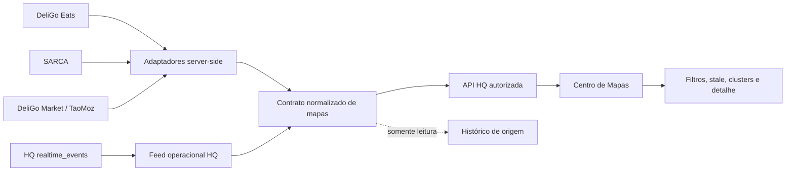

# Fase 10A — Auditoria e arquitetura do Centro de Mapas

Data: 2026-10-23
Branch: `feature/hq-maps-phase10a`
Base estável: `c7df2ef` (`main` após a Fase 9H)

## Escopo e preservação

Esta fase é documental. Não foram executados deploys, migrations, consultas a dados de produção, alterações de RLS/RBAC, alterações financeiras, PaySuite, webhooks ou ativação de rastreamento. A branch foi criada num worktree separado para não misturar a Fase 9 nem alterações não relacionadas do workspace original.

## Inventário confirmado

| Plataforma | Fonte confirmada | Dados geográficos | Estado da fonte |
|---|---|---|---|
| DeliGo Eats | `public.deliveries`, consumido pelo RPC `hq_deligo_operational_map_v1` e `/api/deligo/operational-map` | recolha, entrega e posição corrente do estafeta; `current_latitude`, `current_longitude`, `location_recorded_at` | confirmada para operações DeliGo; depende de GPS recente |
| DeliGo Eats | `public.courier_location_samples` e trigger `capture_courier_location_sample` | amostras históricas por pedido, velocidade, direção, precisão, bateria e hora | confirmada quando a migração/trigger estiver aplicada; acesso RLS é por participante do pedido |
| SARCA | `sarca.driver_profiles`, `sarca.trips`, `sarca.trip_events`, `sarca.trip_status_transitions` | posição corrente do motorista; origem/destino, distância e duração da viagem | confirmada para schema e contratos; não há feed HQ Realtime específico confirmado |
| DeliGo Market/TaoMoz | `taomoz.courier_presence`, `taomoz.shipments`, `taomoz.shipment_events`, `taomoz.shipment_location_history` | presença do entregador, posição e eventos de localização do envio | confirmada para schema; RLS limita presença/histórico ao próprio participante |
| HQ | `hq.realtime_events`, `/api/realtime` | eventos de processos, não coordenadas | confirmada para eventos de workflow; não substitui telemetria geográfica |
| Mapbox | `core.integration_registry` contém `maps_mapbox` como integração planeada | não foi encontrado cliente/endpoint Mapbox operacional confirmado | planeada, não operacional |
| Outras plataformas | nenhuma fonte geográfica verificável encontrada na base auditada | sem rastreamento afirmado | inexistente ou não confirmado |

### Limitações importantes

- Não há evidência, nesta base, de um endpoint HQ que agregue SARCA, DeliGo Market e DeliGo Eats num contrato único além do RPC live-map já existente.
- Não foi encontrado cliente Supabase Realtime no frontend do mapa; a HQ usa polling em `/api/realtime` para eventos `hq.realtime_events`.
- As fontes de posição têm janelas de frescura de cinco minutos no RPC live-map. Isso não prova que uma posição esteja em tempo real; o contrato deve expor `updatedAt` e estado stale.
- Endereço de origem/destino não é uma rota efetivamente percorrida. Rotas Mapbox, caso sejam adicionadas, devem ser classificadas como estimadas.
- A base auditada contém fontes e migrations de seeds históricos; esses dados não podem ser apresentados como telemetria real sem confirmação do ambiente e do evento de origem.

## Arquitetura proposta



Os adaptadores devem ler as fontes de origem no servidor, validar permissões e normalizar respostas. A Central HQ não deve persistir uma segunda cópia de viagens, entregas ou posições. O identificador normalizado deve manter `sourcePlatform`, `sourceTable`, `sourceId` e `sourceEventId` para rastreabilidade.

## Contratos normalizados propostos

```ts
type MapPlatform = "deligo" | "sarca" | "taomoz";
type MapOperation = "delivery" | "trip" | "shipment" | "presence";
type MapStatus = "online" | "busy" | "offline" | "stale" | "unknown";

type GeoPoint = {
  latitude: number;
  longitude: number;
  accuracyMeters?: number | null;
  recordedAt: string;
};

type UnifiedMapOperator = {
  id: string;
  platform: MapPlatform;
  role: "courier" | "driver" | "rider" | "unknown";
  displayName?: string;
  vehicleId?: string | null;
  status: MapStatus;
  location: GeoPoint;
  source: { schema: string; table: string; recordId: string };
};

type UnifiedMapOperation = {
  id: string;
  platform: MapPlatform;
  kind: MapOperation;
  status: string;
  operatorId?: string | null;
  origin?: GeoPoint | null;
  destination?: GeoPoint | null;
  estimatedRoute?: { provider: "mapbox"; geometry: string } | null;
  lastEventAt: string;
  source: { schema: string; table: string; recordId: string };
};
```

`estimatedRoute` deve ser opcional e nunca pode ser confundido com `recordedTrack`. O histórico deve usar os eventos e pontos realmente persistidos na origem.

## Realtime, polling e deduplicação

1. Priorizar uma subscrição server-side autorizada às tabelas de presença/localização quando a plataforma publicar a tabela em `supabase_realtime`.
2. Usar `hq.realtime_events` para mudanças de estado e notificações HQ, não para inventar posições.
3. Enquanto não existir canal geográfico confirmado, usar polling limitado e indicar “última atualização” no UI.
4. Deduplicar por `(platform, sourceTable, sourceId, sourceEventId)`; eventos sem identificador não devem ser agregados silenciosamente.
5. Manter cursor por fonte, reconectar com backoff e descartar eventos fora do âmbito do utilizador.
6. Cancelar subscrições e polling ao sair do Centro de Mapas.
7. Aplicar limites de marcadores, janela temporal e agrupamento antes de renderizar Leaflet.

## Histórico de percursos

| Caso | Fonte real | Pode mostrar |
|---|---|---|
| DeliGo Eats | `courier_location_samples` por `order_id` | pontos registados, hora, precisão, velocidade e direção |
| SARCA | `sarca.trips` + `sarca.trip_events` | origem/destino, estados e eventos; percurso só se eventos carregarem pontos |
| TaoMoz | `shipment_location_history` + `shipment_events.location` | pontos e eventos do envio, quando existentes |
| Qualquer plataforma | Mapbox | apenas rota estimada, explicitamente marcada |

Distância e duração só devem ser mostradas se vierem de campos confirmados (`distance_meters`, `duration_seconds` ou equivalente). Nunca reconstruir uma linha de percurso a partir de origem e destino.

## Matriz de acesso proposta

| Perfil | Visão geral | Localização ao vivo | Histórico | Dados pessoais detalhados |
|---|---:|---:|---:|---:|
| `SUPER_ADMIN` | sim | sim, todas as fontes autorizadas | sim, auditado | mínimo necessário |
| `FINANCE` | não por padrão | não por padrão; somente se permissão operacional explícita | não por padrão | não |
| `SUPERVISOR` | sim, âmbito da equipa/plataforma | sim no âmbito autorizado | sim no âmbito autorizado | mínimo necessário |
| Operações de Campo | módulo de campo | somente plataformas e operações atribuídas | somente casos atribuídos | mínimo necessário |
| Apoio ao Cliente | consulta ligada a ticket/pedido | somente para resolver atendimento autorizado | somente operação ligada ao atendimento | mínimo necessário |
| Outros trabalhadores | não | não | não | não |

Esta é uma proposta; não altera as permissões existentes. A implementação deve chamar autorização server-side, aplicar escopo de plataforma/equipa e criar auditoria para consultas sensíveis e exportações.

## Interface proposta: Centro de Mapas

- **Visão Geral:** contadores de operações com posição fresca, stale e sem sinal; nenhuma pessoa exposta sem necessidade.
- **Operações ao Vivo:** mapa com filtros por plataforma, estado e tipo de operação; painel lateral com origem, destino, estado e `lastUpdated`.
- **Viagens SARCA:** lista de viagens e eventos, com pontos somente quando confirmados.
- **Entregas DeliGo Eats / DeliGo Market:** pedidos/envios ativos, estafeta/entregador autorizado e estado operacional.
- **Histórico:** pesquisa paginada por plataforma, operação e intervalo; rota estimada e percurso registado em visuais separados.
- **Pontos Operacionais:** restaurantes, vendedores e hubs apenas quando houver coordenadas canónicas e permissão.
- **Relatórios Geográficos:** somente agregados autorizados; exportações devem ser auditadas e limitadas.

No marcador, usar apenas identificador operacional mascarado, papel, plataforma, estado e hora da última posição. Nome, telefone, endereço completo e dados do cliente ficam no detalhe autorizado, não no mapa público.

## Performance, privacidade e custos

- Limitar atualização por operador e plataforma; não renderizar cada evento individual.
- Paginar histórico e usar janelas temporais curtas para o mapa ao vivo.
- Aplicar clustering e bounding box no servidor quando o volume justificar.
- Não criar índices ou migrations nesta fase; avaliar índices futuros para `(status, updated_at)`, `(operator_id, recorded_at)` e escopo de plataforma.
- Confirmar custos e limites do provedor de tiles antes de introduzir Mapbox; atualmente a fonte encontrada é OSM/Leaflet no componente existente e Mapbox está apenas planeado.
- Definir retenção de localização, acesso justificado e remoção/anonimização conforme finalidade legítima e política interna.
- Proteger contra consultas em massa, paginação abusiva e exportação de trajetos identificáveis.

## Plano 10B–10E

1. **10B — contratos e adaptadores read-only:** implementar tipos, validadores e adaptadores para as três fontes confirmadas, sem migrations.
2. **10C — live map autorizado:** endpoint agregado server-side, filtros, stale, deduplicação e testes de permissões; primeiro com polling controlado.
3. **10D — Realtime e histórico:** ativar somente canais já publicados, reconexão, cursores, histórico paginado e distinção de rota estimada/percurso registado.
4. **10E — interface e operação:** Centro de Mapas responsivo, relatórios agregados, auditoria, limites de custo e validação autenticada em staging.

## Bloqueios para 10B

- Confirmar em staging quais migrations 288, 295, 336, 341 e 343 estão aplicadas e quais tabelas têm dados reais.
- Confirmar o contrato de acesso ao RPC `hq_live_map_v1` e o armazenamento seguro do segredo de integração.
- Confirmar canais Realtime de localização por plataforma; `hq.realtime_events` sozinho não fornece coordenadas.
- Definir a política formal de retenção e autorização de localização.
- Não implementar ainda Mapbox, novas migrations, índices, rastreamento ou qualquer escrita nas fontes.

## Ficheiros analisados

- `components/LiveOperationsMap.tsx`
- `app/components/DeligoOperationalMap.tsx`
- `app/api/deligo/operational-map/route.ts`
- `app/api/map/route.ts`
- `app/api/realtime/route.ts`
- `lib/realtime-feed.ts`
- `supabase/migrations/281_maps_gateway_cache.sql`
- `supabase/migrations/288_courier_location_telemetry.sql`
- `supabase/migrations/295_sarca_identity_and_mobility.sql`
- `supabase/migrations/297_taomoz_marketplace_and_logistics.sql`
- `supabase/migrations/336_taomoz_realtime_communication_tracking.sql`
- `supabase/migrations/341_hq_live_map_read_api.sql`
- `supabase/migrations/342_hq_map_monitoring.sql`
- `supabase/migrations/343_hq_live_map_authorized_workers.sql`
- `supabase/migrations/373_hq_realtime_process_activity_and_comments.sql`
- `supabase/migrations/317_central_integration_registry.sql`

## Resultado

A arquitetura é tecnicamente viável para iniciar a Fase 10B em modo read-only, mas os bloqueios de ambiente, canais Realtime geográficos, retenção e autorização devem ser resolvidos antes de afirmar que existe mapa em tempo real multiplataforma.
